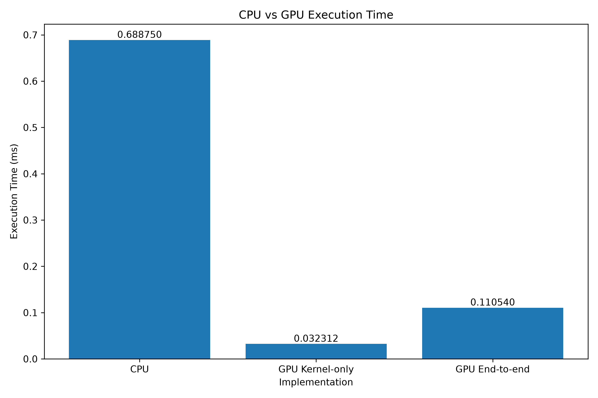
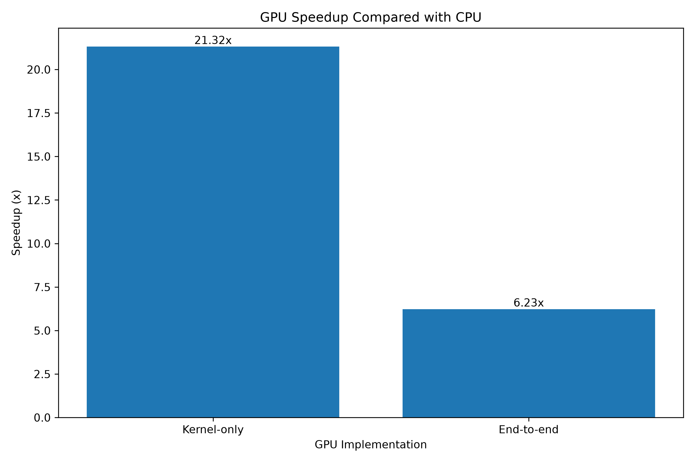
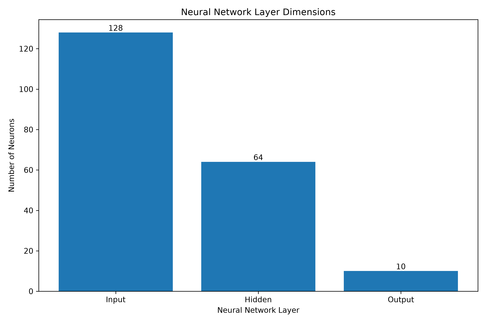
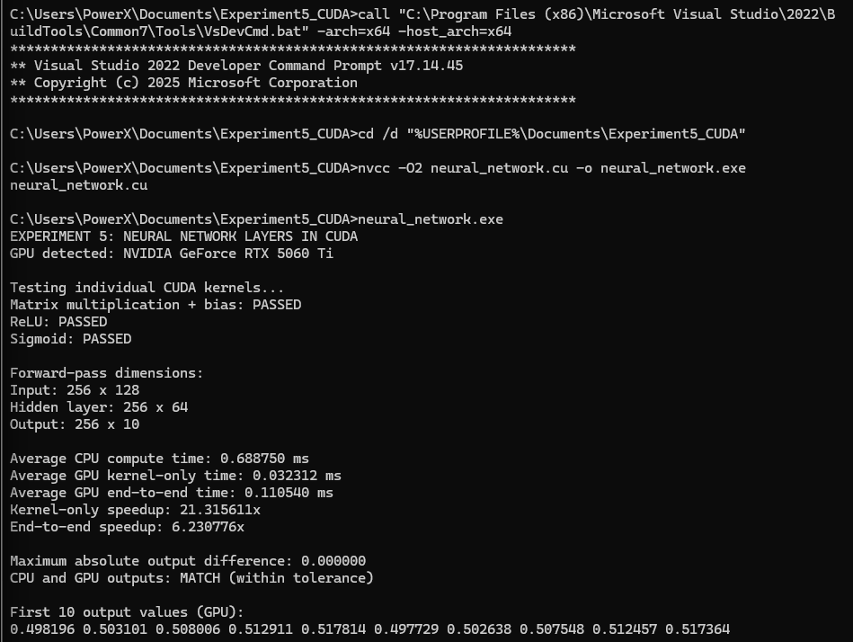

# Experiment 5: Neural Network Layers in CUDA
---

## 1. Aim

To implement and evaluate basic neural-network layers using custom CUDA kernels: matrix multiplication with bias, ReLU activation and sigmoid activation.

The same neural-network forward pass is executed on both CPU and GPU. The results are compared to verify numerical correctness, execution times are measured, and GPU speedup is calculated.

## 2. Learning Outcomes

1. Understand CUDA kernels, blocks, threads and grid dimensions.
2. Implement matrix multiplication with bias using CUDA.
3. Implement ReLU and sigmoid activation functions.
4. Allocate GPU memory and transfer data between host and device.
5. Compare CPU and GPU computation results.
6. Measure execution time and calculate GPU speedup.

### Hardware and Software Requirements

| Component | Configuration |
|---|---|
| GPU | NVIDIA GeForce RTX 5060 Ti |
| GPU Memory | 16 GB |
| CUDA Toolkit | 13.4 |
| Compiler | Visual Studio 2022 Build Tools |
| Operating System | Windows 11 |
| Programming Language | CUDA C++ |
| Graph Generation | Python and Matplotlib |

## 3. Theory

A neural network forward pass calculates outputs by applying weighted sums and activation functions.

This experiment implements a two-layer feed-forward neural network.

### 3.1 First Layer

Matrix multiplication with bias:

\[
Z_1 = X \times W_1 + b_1
\]

ReLU activation:

\[
A_1 = ReLU(Z_1)
\]

### 3.2 Second Layer

Matrix multiplication with bias:

\[
Z_2 = A_1 \times W_2 + b_2
\]

Sigmoid activation:

\[
Y = Sigmoid(Z_2)
\]

This experiment performs inference (forward propagation) only. It does not include training, loss calculation, an optimizer or backpropagation.

### 3.3 Matrix Multiplication with Bias

For matrices A and B:

\[
C[row,col] = \sum_k A[row,k]\times B[k,col]+bias[col]
\]

Each CUDA thread calculates one output matrix element.

### 3.4 ReLU Activation

\[
ReLU(x)=\max(0,x)
\]

Negative values become zero, while positive values remain unchanged.

### 3.5 Sigmoid Activation

\[
Sigmoid(x)=\frac{1}{1+e^{-x}}
\]

It converts input values into a range between 0 and 1.

### 3.6 CPU and GPU Execution

- **CPU:** Uses ordinary nested loops and standard C++ functions.
- **GPU:** Transfers input data and weights to device memory, launches CUDA kernels and transfers the final output back to the CPU.

## 4. Neural Network Configuration

| Parameter | Value |
|---|---:|
| BATCH | 256 |
| INPUT_SIZE | 128 |
| HIDDEN_SIZE | 64 |
| OUTPUT_SIZE | 10 |
| REPEATS | 20 |

### Tensor Dimensions

| Tensor | Shape |
|---|---|
| Input X | 256 × 128 |
| Weight W1 | 128 × 64 |
| Bias b1 | 64 elements |
| Hidden activation | 256 × 64 |
| Weight W2 | 64 × 10 |
| Bias b2 | 10 elements |
| Final output | 256 × 10 |

The input and weights are generated using deterministic sine and cosine functions so that the CPU and GPU receive identical data.

## 5. Procedure: Windows Setup

### Step 1: Check the NVIDIA GPU and Driver

Open Command Prompt and execute:

```cmd
nvidia-smi
```

This command displays the NVIDIA GPU name, driver version, CUDA compatibility information and GPU memory.

**Observed GPU:** NVIDIA GeForce RTX 5060 Ti.

### Step 2: Check the CUDA Compiler

Execute:

```cmd
nvcc --version
```

This verifies that the CUDA compiler is installed and accessible.

### Step 3: Find the CUDA Compiler Location

Execute:

```cmd
where.exe nvcc
```

This displays the location of `nvcc.exe`.

### Step 4: Configure the Visual Studio C++ Compiler

CUDA requires Microsoft's C++ compiler (`cl.exe`).

The Visual Studio 2022 Build Tools installation must include:

- Desktop development with C++
- MSVC v143 x64/x86 build tools
- Windows 10 or Windows 11 SDK

### Step 5: Initialize the Developer Environment

In normal CMD, execute:

```cmd
call "C:\Program Files (x86)\Microsoft Visual Studio\2022\BuildTools\Common7\Tools\VsDevCmd.bat" -arch=x64 -host_arch=x64
```

Verify the compiler:

```cmd
where cl
```

The command should display the location of `cl.exe`.

**Important:** Use the initialized Developer Command Prompt environment for compiling the CUDA program.

## 6. Procedure: Create the CUDA Project

### Step 1: Create the Project Folder

```cmd
mkdir "%USERPROFILE%\Documents\Experiment5_CUDA"
```

### Step 2: Open the Project Folder

```cmd
cd /d "%USERPROFILE%\Documents\Experiment5_CUDA"
```

### Step 3: Create the CUDA Source File

```cmd
notepad neural_network.cu
```

Create the file in Notepad and save it with the `.cu` extension.

### Step 4: Implement the Program in Eight Phases

The complete CUDA program is available in:

**[neural_network.cu](neural_network.cu)**

The program is developed in the following eight phases.

| Phase | Implementation |
|---|---|
| Phase 1 | Header files, CUDA error checking and network constants |
| Phase 2 | CUDA kernels for matrix multiplication, ReLU and sigmoid |
| Phase 3 | CPU implementation of the neural-network forward pass |
| Phase 4 | GPU forward-pass kernel launches and numerical comparison helper |
| Phase 5 | Individual CUDA kernel validation tests |
| Phase 6 | GPU detection, input generation and CPU execution timing |
| Phase 7 | GPU memory allocation, data transfer, warm-up and GPU timing |
| Phase 8 | CPU/GPU comparison, result printing and GPU memory cleanup |

### Important CUDA Kernel Code

**1. Matrix Multiplication with Bias**

```cpp
__global__ void matrixMulBiasKernel(
    const float* A, const float* B,
    const float* bias, float* C,
    int M, int N, int K)
{
    int row = blockIdx.y * blockDim.y + threadIdx.y;
    int col = blockIdx.x * blockDim.x + threadIdx.x;

    if (row < M && col < N) {
        float sum = 0.0f;

        for (int k = 0; k < K; ++k) {
            sum += A[row * K + k] * B[k * N + col];
        }

        C[row * N + col] = sum + bias[col];
    }
}
```

**2. ReLU Activation Kernel**

```cpp
__global__ void reluKernel(float* values, int count)
{
    int idx = blockIdx.x * blockDim.x + threadIdx.x;

    if (idx < count) {
        values[idx] = fmaxf(0.0f, values[idx]);
    }
}
```

**3. Sigmoid Activation Kernel**

```cpp
__global__ void sigmoidKernel(float* values, int count)
{
    int idx = blockIdx.x * blockDim.x + threadIdx.x;

    if (idx < count) {
        values[idx] = 1.0f / (1.0f + expf(-values[idx]));
    }
}
```

The complete source code, including CPU functions, GPU memory management, kernel tests, timing and output validation, is provided in `neural_network.cu`.

### Step 5: Compile the Complete Program

Execute:

```cmd
nvcc -O2 neural_network.cu -o neural_network.exe
```

The CUDA compiler generates the executable file.

### Step 6: Verify the Executable

```cmd
dir neural_network.exe
```

The executable should be listed in the project directory.

## 7. Procedure: Program Execution and Validation

### Step 1: Execute the Program

```cmd
neural_network.exe
```

### Step 2: Validate the Individual CUDA Kernels

The program performs three individual kernel tests.

| Test | Input | Expected Output |
|---|---|---|
| Matrix multiplication + bias | A = [[1,2,3],[4,5,6]], B = [[1,2],[3,4],[5,6]], bias = [1,-1] | [[23,27],[50,63]] |
| ReLU | [-2,0,3,-4,5] | [0,0,3,0,5] |
| Sigmoid | [-2,0,2] | [0.119203, 0.5, 0.880797] |

All three tests must display `PASSED`.

### Step 3: Check the Forward-Pass Dimensions

The program should display:

- Input: 256 × 128
- Hidden layer: 256 × 64
- Output: 256 × 10

### Step 4: Compare CPU and GPU Results

The program calculates the maximum absolute difference between CPU and GPU output values.

The outputs are considered matching when:

\[
Maximum\ Difference < 0.0001
\]

The expected validation message is:

```text
CPU and GPU outputs: MATCH (within tolerance)
```

### Step 5: Record the Execution Results

Record the CPU time, GPU kernel-only time, GPU end-to-end time and speedup values printed by the program.

### Step 6: Repeat the Execution

Run the executable two more times to observe timing variations.

The experiment records the actual run presented in the observation table below.

10. Observation Table and Actual Results

The following values were obtained from the experiment executed on the NVIDIA GeForce RTX 5060 Ti.

Measurement

Actual Result

Average CPU compute time

0.688750 ms

Average GPU kernel-only time

0.032312 ms

Average GPU end-to-end time

0.110540 ms

Kernel-only speedup

21.315611×

End-to-end speedup

6.230776×

Maximum absolute output difference

0.000000

Performance Calculation

Kernel-only speedup:

[
\frac{0.688750}{0.032312}=21.315611\times
]

End-to-end speedup:

[
\frac{0.688750}{0.110540}=6.230776\times
]

The GPU kernel-only execution is approximately 21.32 times faster than the CPU computation for this measurement.

The complete GPU operation, including memory transfers, is approximately 6.23 times faster.
### Graph 1: CPU vs GPU Execution Time



**Observation:** The GPU kernel-only execution time is lower than the CPU execution time. The end-to-end GPU time is higher than kernel-only time because it includes memory transfers and synchronization.

### Graph 2: GPU Speedup Comparison



**Observation:** The kernel-only speedup is 21.315611×, while the end-to-end speedup is 6.230776×.

### Graph 3: Neural Network Layer Dimensions



**Observation:** The network processes 128 input features, 64 hidden-layer neurons and 10 output neurons.

## 12. Output Screenshot

The following screenshot records the successful execution of the CUDA program on the NVIDIA GeForce RTX 5060 Ti.

### Successful Execution Output



### Output Verification

| Verification | Result |
|---|---|
| GPU detected | NVIDIA GeForce RTX 5060 Ti |
| Matrix multiplication + bias | PASSED |
| ReLU | PASSED |
| Sigmoid | PASSED |
| CPU and GPU dimensions | Correct |
| Maximum output difference | 0.000000 |
| CPU and GPU outputs | MATCH (within tolerance) |

### First 10 GPU Output Values

```text
0.498196 0.503101 0.508006 0.512911 0.517814
0.497729 0.502638 0.507548 0.512457 0.517364
```

## 15. Result

The neural-network layers were successfully implemented using custom CUDA kernels.

Matrix multiplication with bias, ReLU activation and sigmoid activation were individually tested and passed.

The two-layer neural-network forward pass was executed on both CPU and GPU. The maximum absolute output difference was 0.000000, confirming that the CPU and GPU outputs matched within the specified tolerance.

The experiment achieved a kernel-only speedup of **21.315611×** and an end-to-end speedup of **6.230776×** on the NVIDIA GeForce RTX 5060 Ti.

## 16. Conclusion

Thus, the implementation and evaluation of neural-network layers using CUDA were successfully completed.

The experiment demonstrated how custom CUDA kernels perform matrix multiplication with bias and activation functions on the GPU. The CPU and GPU outputs were verified successfully, and execution-time measurements showed the performance advantage of GPU computation.

The experiment also demonstrated the effect of memory-transfer overhead on end-to-end execution time.

---

## 17. Project Folder Structure

```text
Experiment5_CUDA/
│
├── neural_network.cu
├── create_graphs.py
├── README.md
├── .gitignore
│
├── graphs/
│   ├── execution_time.png
│   ├── speedup.png
│   └── layer_dimensions.png
│
└── screenshots/
    └── 03_execution_output.png
```

**End of Experiment 5**
